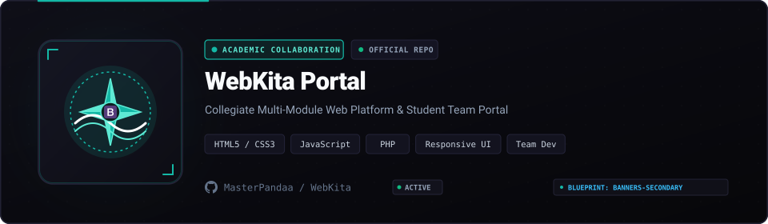

<p align="center">
  
</p>

<p align="center">
  
  
  
  <a href="LICENSE"></a>
</p>

## Overview

WebKita is a collaborative web development portal engineered as academic coursework. Built with **HTML5**, **CSS3**, and **vanilla JavaScript**, the project demonstrates modular layout principles, mobile-first responsive design, and cohesive team git branching workflows.

---

## Core Capabilities

- **Responsive Grid Architecture**: Fluid viewport adaptation across mobile, tablet, and desktop displays.
- **Component Styling**: Clean CSS design systems with consistent typography, button states, and card components.
- **Collaborative Git Structure**: Demonstrates multi-contributor branching, code reviews, and structured directory organization.

---

## Quickstart

```bash
git clone https://github.com/MasterPandaa/WebKita.git
cd WebKita
# Open index.html directly in any web browser
```

---

## License

This project is licensed under the [MIT License](LICENSE).
